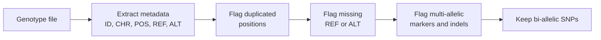
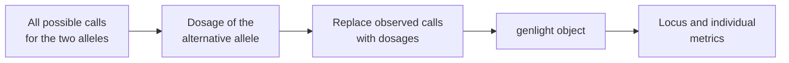

<!-- badges: start -->
[](https://www.repostatus.org/#active)
[](https://lifecycle.r-lib.org/articles/stages.html#experimental)
[](LICENSE.md)
<!-- badges: end -->

# cgiarGenomics

*Reading, quality control and imputation of SNP marker data for breeding programmes*

**cgiarGenomics** is the genomic data engine of [Bioflow](https://github.com/Breeding-Analytics/bioflow), the open-source breeding analytics pipeline of CGIAR. It reads marker data from the formats genotyping providers deliver, turns them into one compact object, and prepares them for genomic analysis. It handles diploid and polyploid bi-allelic SNPs, so it serves cereals and legumes as well as clonal crops such as potato, sweetpotato and cassava.

Breeding teams receive markers as hapmap files, VCFs and DArT reports, each with its own conventions for alleles, ploidy and missing data. Before any genomic prediction or diversity analysis, those files need the same cleaning steps. cgiarGenomics does those steps the same way every time. It reads the file, keeps the usable bi-allelic SNPs, converts calls to allele dosages, measures quality, filters, merges replicate samples, imputes missing calls and writes the result back to VCF. Bioflow runs these steps behind its interface, and the package also works on its own in R.

## Use it with an AI assistant

Share this link with an AI assistant that can read the web, and ask your question.

```text
https://github.com/Breeding-Analytics/cgiarGenomics
```

The assistant reads [`AGENTS.md`](AGENTS.md) and [`SKILL.md`](SKILL.md), which tell it which function fits each task and which pitfalls to avoid. Both are plain markdown, so they work with any assistant. In Claude, you can also upload `SKILL.md` as a skill.

## Installation

Install the development version from GitHub.

```r
# install.packages("remotes")
remotes::install_github("Breeding-Analytics/cgiarGenomics")
```

Some readers and imputation methods use optional packages. Check what is missing and install it from R.

```r
library("cgiarGenomics")

check_dependencies()
install_optional_deps()
```

| Optional package | Unlocks |
|---|---|
| vcfR | `read_vcf()` and Beagle imputation |
| randomForest | `impute_gl(method = "random_forest")` |
| dartR.base | `read_DArTSeq_SNP()`, which also needs SNPRelate and snpStats from Bioconductor |

Beagle imputation also needs Java 8 or later. The Beagle 5.5 JAR ships with the package. Run `check_beagle_requirements()` to confirm everything is in place.

## Quick start

This example reads a diploid VCF, filters it by missingness and imputes the remaining gaps.

```r
library("cgiarGenomics")

gl = read_vcf("diploid.vcf.gz", ploidity = 2)

get_overall_summary(gl)

steps = list(
  list(param = "loc_miss", operator = "<=", threshold = 0.2),
  list(param = "ind_miss", operator = "<=", threshold = 0.3)
)

filtered = apply_sequence_filtering(gl, steps)

imputed = impute_gl(filtered$gl, ploidity = 2, method = "frequency")

write_vcf(imputed$gl, "diploid_clean.vcf.gz")
```

Example files for every format are in [`tests/`](tests), including diploid, tetraploid and hexaploid hapmap files, VCFs, a DArTSeq report and DArTag reports for bean and sweetpotato.

## Supported formats

| Format | Function | Ploidy |
|---|---|---|
| Hapmap | `read_hapmap()` | diploid and polyploid |
| VCF, compressed or not | `read_vcf()` | diploid and polyploid |
| DArTSeq SNP report | `read_DArTSeq_SNP()` | diploid |
| DArTag dosage report with allele counts | `read_DArTag_count_dosage()` | diploid and polyploid |

**Hapmap.** The first eleven columns follow the hapmap standard, and samples start at column 12. The `alleles` column separates reference and alternative with `/`, as in `A/G`. Calls are written in full, `AG` for a diploid and `AAGG` for a tetraploid. Diploid files with one IUPAC code per call, as TASSEL writes them, are read as well.

| rs# | alleles | chrom | pos | strand | assembly# | center | protLSID | assayLSID | panelLSID | QCcode | sample_1 |
|---|---|---|---|---|---|---|---|---|---|---|---|
| 44509 | A/G | Chr02 | 5565755 | NA | NA | NA | NA | NA | NA | NA | AAGG |

**VCF.** Any VCF with a `GT` field. Phased and unphased calls are both read, also when one file mixes them.

| #CHROM | POS | ID | REF | ALT | QUAL | FILTER | INFO | FORMAT | sample_1 |
|---|---|---|---|---|---|---|---|---|---|
| Chr01 | 510745 | solcap_snp_c2_36615 | T | G | . | . | NS=367 | GT:AD:DP | 0/0/0/1:47,9:56 |

**DArTSeq.** The standard SNP report from Diversity Arrays Technology, read with `gl.read.dart()` from [dartR](https://green-striped-gecko.github.io/dartR/). Name the columns that hold the marker ID, chromosome and position.

**DArTag.** The dosage report and the collapsed allele match counts file. The reference and alternative alleles come from the single base that differs between the two tag sequences.

## How it works

Every reader produces a [genlight](https://github.com/thibautjombart/adegenet) object from adegenet. genlight stores eight SNPs in one byte, which keeps large panels small in memory, and it supports any ploidy. Each cell holds the dosage of the alternative allele, from 0 to the ploidy.

Before building the object, the reader checks each marker and keeps only bi-allelic SNPs with a known position.



It then converts each call to a dosage, builds the genlight object and computes quality metrics.



The metrics sit in the `other` slot of the object, as `loc.metrics` (MAF, missingness, heterozygosity and Fis per locus) and `ind.metrics` (missingness and heterozygosity per individual). Filters read them by name, and every filtering or imputation step recalculates them.

## Main functions

| Task | Function |
|---|---|
| Read markers | `read_hapmap()`, `read_vcf()`, `read_DArTSeq_SNP()`, `read_DArTag_count_dosage()` |
| Summarise quality | `get_overall_summary()`, `recalc_metrics()` |
| Missingness, MAF and heterozygosity | `get_loc_missing()`, `get_ind_missing()`, `get_maf()`, `get_heterozygosity_metrics()` |
| Filter loci and individuals | `apply_sequence_filtering()`, `filter_gl()` |
| Thin a panel | `random_select_loci()` |
| Impute missing calls | `impute_gl()` with `"frequency"`, `"random_forest"` or `"beagle"` |
| Test imputation accuracy | `set_fraction_na()`, `get_accuracy()` |
| Merge replicate samples | `merge_duplicate_inds()` |
| Identity and pedigree checks | `ibs_matrix_purrr()`, `get_mendelian_error_counts()` |
| Write VCF | `write_vcf()` |
| Replay Bioflow decisions | `apply_bioflow_modifications()` |

[`REFERENCE.md`](REFERENCE.md) documents every function, with arguments and return values.

## Status

Version 1.0.3 is the development version on this branch. It follows two reviews of version 1.0.2 in November 2026, a code audit and an external review that ran the package. Both found defects that changed results without an error, among them minor allele frequencies divided by ploidy twice, Random Forest imputation that wrote impossible dosages, and filters that were skipped when nothing passed them.

Version 1.0.3 fixes those defects. Each fix has a unit test, and the tests and `R CMD check` run on every pull request. [`NEWS.md`](NEWS.md) lists every result that changes, and [`dev/audit.md`](dev/audit.md) records each finding with its status.

Results from version 1.0.2 that used a MAF filter, marker thinning, Fis, heterozygosity, Random Forest imputation or replicate merging differ from results of version 1.0.3. Rerun those analyses before relying on them.

A few findings stay open. `loc_Fis` assumes a diploid, `apply_bioflow_modifications()` replays removals only, and the argument for ploidy is spelled `ploidity` in some functions and `ploidy` in others.

## Contributing

Report bugs and ideas in the [issue tracker](https://github.com/Breeding-Analytics/cgiarGenomics/issues). Work on a branch and open a pull request. Every fix needs a test that fails before it and passes after it, and the `tests` workflow has to pass. [`AGENTS.md`](AGENTS.md) sets the rules for changing the package, for people and AI assistants alike.

## Cite

Cite the package in R with `citation("cgiarGenomics")`, or use [`CITATION.cff`](CITATION.cff), which GitHub shows under "Cite this repository". When you use it through Bioflow, cite Bioflow as well. Cite Beagle too when you impute with it.

## License

The package is released under the [MIT License](LICENSE.md), copyright CGIAR Breeding Analytics Team.

The bundled Beagle JAR is a separate program under the GNU General Public License, version 3 or later. [`inst/extdata/README.md`](inst/extdata/README.md) gives its source, version and checksum.

Contact the Breeding Analytics team at breedinganalytics@cgiar.org.
